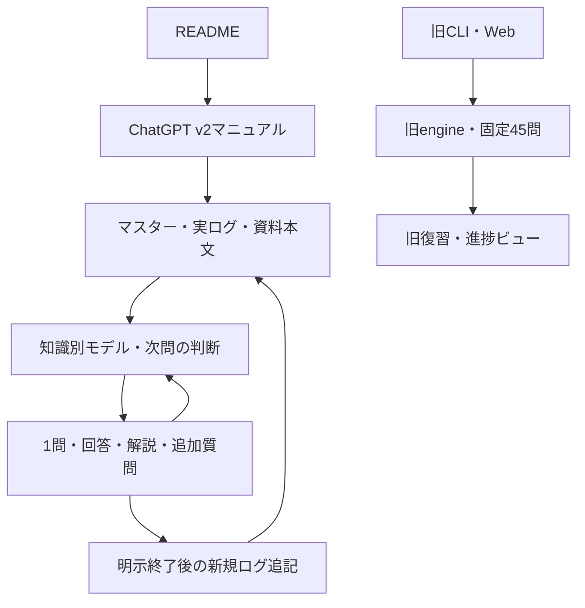

# v2現状調査・移行判断

調査基準：main `62401bdf83ff0351a4e9d66fce5b049fac533bcf`。2026-10-20にコネクタでtreeと55 blobの本文を取得。ローカルgit cloneは認証情報がなく失敗したため、コネクタで全ファイルを取得しGit blob SHAを照合した。AGENTS.mdは取得treeに存在しなかった。

## 旧構造と新経路

[全55ファイルの依存関係](v2_依存関係.csv)を参照。新経路は旧engineを呼ばない。旧app同士の参照は保全する。

## 発見した矛盾・不足と処置
| 元の状態 | v2での処置 |
|---|---|
| 問題演習の冒頭は固定問題優先、末尾は個別理解と選択式希望 | 全文を個別作問の手順に統一 |
| 学習開始は試用5問のある区画優先 | 実ログの弱点・期限・ユーザー希望・未学習を優先 |
| START_HERE・使い方は旧Web/CLIを起動 | ChatGPT入口へ統一 |
| 旧復習は正答率と区画単位、主観の必要性は補助のみ | 知識別の状態・主観希望・定着確認を組み合わせたv2ルール |
| 動的に問題を決めたいがstart時に全5問固定 | 1問ずつsnapshotとattemptを追記するv2イベント |
| BIOのreview_necessityとCHE/PHA1のreview_needが別名 | 読み取り時に統一し、原ログは維持 |
| BIO/PHA1代替問題と元textが異なる | 暫定結果・未回答の原textを別管理 |
| CHEはcheckpointだけでstartがなく、代替本文も不足 | 既知の実回答だけ保持。本文・根拠の再現不能を記録し推測補完しない |
| 旧ダッシュボードは空履歴時の値、復習JSONも空 | 旧キャッシュと表示し、都度実ログから算出。既存ファイルは更新しない |

## 保護対象
学習マスター全6 blob（空フォルダ維持ファイル含む）、既存ログ全11 blob（10実イベント＋空フォルダ維持）、questions.jsonの45問、build_master.pyと資料入力は変更しない。保護SHAは `tests/fixtures/protected_blobs.json`。元問題のID・版・正答・選択肢・根拠をそのまま参照可能。既存ログの形式不足を修正していない。

## 削除候補（今回の物理削除は0件）
| 候補 | 理由 | 影響・保留理由 |
|---|---|---|
| app/cli.py, server.py, app.js, index.html, style.css | 旧ローカルUI | 相互参照と旧試験が依存。明示削除承認待ち |
| app/engine.py | 固定先頭5問・旧復習・区画採点 | 旧CLI/Web/テストが依存。新方式とは非互換。承認待ち |
| 起動.bat, start.sh | 旧アプリ入口 | 旧起動手順と関連。現行手順から外し、承認待ち |
| scripts/seed_questions.py | 固定試用45問の再生成 | 実行するとアーカイブ上書きになる。現行から呼ばず保全、承認待ち |
| tests/test_system.py | 旧アプリの16試験 | 旧互換検証を保持。v2は別test_adaptive.pyに置き換えた運用。削除承認待ち |

questions.jsonは削除候補にしない。旧45問本文を保全し、運用索引の36選択式候補と役割を分離した。元text9問は履歴参照用。学習マスター生成は粒度追加改善の対象ではなく、build_master.pyを今回実行しない。

## GitHub反映の単位
v2運用と補助・試験を作業ブランチへ1コミット。削除は含めない。mainへのMergeは承認後。後日、削除対象を承認する場合も別コミット・別検証とし、問題アーカイブと実ログを残す。
